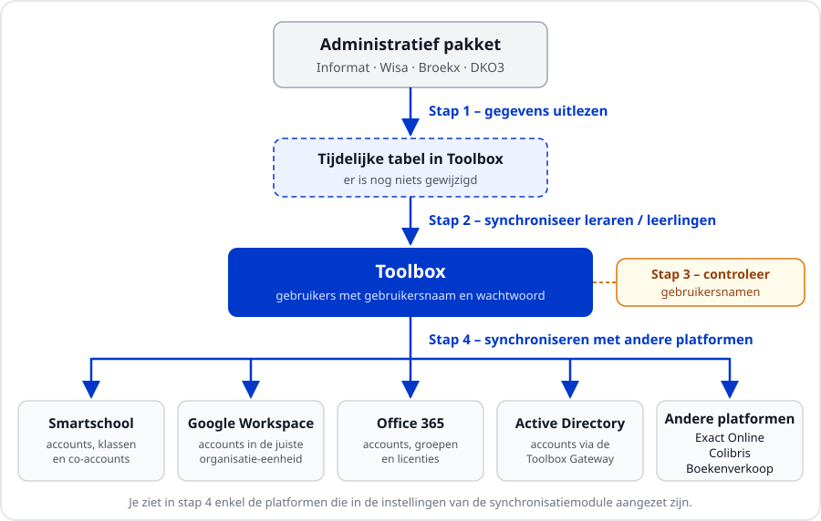

<ImageTitle img="externen.png">Aan de slag met synchroniseren</ImageTitle>

Ben je nieuw in Toolbox en moet je de synchronisaties uitvoeren? Dan ben je hier aan het juiste adres. Dit stappenplan legt uit in welke volgorde je de synchronisaties uitvoert, wat er bij elke stap gebeurt en waar je extra moet opletten. De technische koppelingen (bv. de Toolbox Gateway of de app-registratie bij Microsoft) moeten op voorhand al in orde zijn. Die vind je verder in het onderdeel [Synchronisatiemodules](/synchronisatie).

## Het principe

Het **administratief pakket** (Informat, Wisa, Broekx of DKO3) is altijd het vertrekpunt. Daar worden personeelsleden en leerlingen ingeschreven en up-to-date gehouden. Toolbox haalt die gegevens op, maakt er gebruikers van met een gebruikersnaam en een wachtwoord en stuurt ze daarna door naar de andere platformen die de school gebruikt, zoals Smartschool, Google Workspace, Office 365 of Active Directory.

Dat betekent ook:
- Personeelsleden en leerlingen maak je **nooit manueel** aan in Toolbox. Ontbreekt er iemand, kijk dan eerst na of die persoon correct in het administratief pakket staat.
- Gegevens zoals naam, adres of klas wijzig je **in het administratief pakket** en niet in Toolbox. Bij de volgende synchronisatie worden ze automatisch overgenomen.
- Accounts die door Toolbox beheerd worden, maak je bij voorkeur ook niet manueel aan in Smartschool, Google of Microsoft. Zo voorkom je dubbele accounts en verschillende gebruikersnamen.

## De synchronisatiemodules

Er is een aparte synchronisatiemodule per doelgroep. Elke module werkt op dezelfde manier.

| Module | Voor wie? | Gegevens komen uit |
| --- | --- | --- |
| **Synchronisatie leraren** | alle personeelsleden | Informat, Wisa, Broekx of DKO3 |
| **Synchronisatie leerlingen** | leerlingen secundair onderwijs | Informat, Wisa, Broekx of DKO3 |
| **Synchronisatie leerlingen basisschool** | leerlingen basisonderwijs | Informat, Wisa, Broekx of DKO3 |
| **Synchronisatie leerlingen internaat** | internen | Informat of Wisa |
| **Synchronisatie externen** | externe medewerkers (CLB, ondersteuners, ...) | worden in Toolbox zelf beheerd |

Zie je de module niet op je startpagina? Vraag dan aan een beheerder om je het juiste gebruikersrecht te geven via de module [Gebruikersbeheer](/gebruikersbeheer). Het gebruikersrecht heeft dezelfde naam als de module:
- `synchronisatie_leraren`
- `synchronisatie_leerlingen`
- `synchronisatie_leerlingen_basisschool`
- `synchronisatie_leerlingen_internaat`
- `synchronisatie_externen`

Uit welk administratief pakket de gegevens komen, stel je in via **Instellingen => Synchronisatie leraren => Gegevens leraren ophalen uit** en **Instellingen => Synchronisatie leerlingen => Gegevens leerlingen ophalen uit**.

## Zo ziet een synchronisatiemodule eruit

Links staat het menu, rechts verschijnt het verslag van de stap die je uitvoert. Het menu is opgedeeld in blokken:

1. **Ophalen en synchroniseren**: *Informat uitlezen* (of *Wisa*, *Broekx* of *DKO3 uitlezen*), *Synchroniseer leraren/leerlingen* en *Controle gebruikersnamen*.
2. **Google en Office 365**: *Synchroniseer met Google* en *Synchroniseer met Office365*.
3. **Andere platformen**: *Synchroniseer met ActiveDirectory*, *Synchroniseer met Exact Online*, *Synchroniseer met Colibris*, ...
4. **Smartschool**: een blok per Smartschoolplatform, met de naam van het platform als titel.
5. **Inloggegevens**: *PDF afdrukken* en *Exporteer XLSX*.

Je ziet enkel de onderdelen die voor jouw school aangezet zijn. Of een platform in het menu verschijnt, bepaal je in de instellingen van de synchronisatiemodule (bv. **Instellingen => Synchronisatie leraren => Synchroniseer met Office365**).

:::tip geduld
Het verslag verschijnt pas wanneer een stap volledig klaar is. Bij grote scholen kan dat enkele minuten duren. Zolang je het laadicoon ziet, klik je niet opnieuw en sluit je de pagina niet.
:::

## De volgorde in het kort

Voer de synchronisaties altijd in deze volgorde uit:

1. **[Administratief pakket uitlezen](/synchronisatie/stappenplan/administratief_pakket/)**: de meest recente gegevens ophalen.
2. **[Synchroniseren naar Toolbox](/synchronisatie/stappenplan/administratief_pakket/#stap-2-synchroniseren-naar-toolbox)**: nieuwe personen toevoegen, gewijzigde gegevens bijwerken en vertrokken personen uit dienst zetten of uitschrijven.
3. **[Gebruikersnamen controleren](/synchronisatie/stappenplan/gebruikersnamen_uit_dienst/)** en eventueel personeelsleden **uit dienst zetten** die niet mee gesynchroniseerd mogen worden.
4. **Synchroniseren met de andere platformen**: [Smartschool](/synchronisatie/stappenplan/smartschool/), [Google](/synchronisatie/stappenplan/google/) en [Microsoft (Office 365 en Active Directory)](/synchronisatie/stappenplan/microsoft/). De volgorde tussen deze platformen maakt niet uit.
5. **Inloggegevens bezorgen** aan nieuwe personeelsleden en leerlingen via *PDF afdrukken* of *Exporteer XLSX*. Meer info vind je bij [Synchronisatie leraren](/synchronisatie/synchronisatie_leraren/#inloggegevens) en [Synchronisatie leerlingen](/synchronisatie/synchronisatie_lln/#inloggegevens).

:::caution opgelet
Begin altijd met stap 1 en 2. Synchroniseer je meteen met bv. Smartschool of Office 365, dan werk je met de gegevens van de vorige keer en worden nieuwe personeelsleden of leerlingen nog niet meegenomen.
:::

## Hoe vaak synchroniseren?

Synchroniseer telkens wanneer er iets gewijzigd is in het administratief pakket: een nieuw personeelslid, een personeelslid dat vertrekt, een nieuwe leerling, een klaswijziging, ... Rond de start van het schooljaar is dat vaak, tijdens het schooljaar kan je bijvoorbeeld wekelijks synchroniseren.

Wil je eind augustus al de leerlingen en personeelsleden van het nieuwe schooljaar ophalen? Stel dan eerst de referentiedatum in zoals beschreven bij [Opstart schooljaar](/opstart_schooljaar).

## Vijf gouden regels

1. **Eerst uitlezen, dan synchroniseren.** Stap 1 en 2 komen altijd eerst.
2. **Eerst kijken, dan uitvoeren.** Bij Smartschool kan je de wijzigingen eerst enkel laten tonen. Bij Office 365, Active Directory en Google zie je eerst een lijst met voorgestelde wijzigingen die je pas daarna uitvoert. Lees die lijst altijd na.
3. **Verwijder nooit blind.** Toolbox stelt soms voor om accounts te verwijderen of inactief te zetten. Kijk telkens na of dat de bedoeling is: verwijderde accounts en hun gegevens krijg je meestal niet meer terug.
4. **Eén gebruikersnaam overal.** De gebruikersnaam in Toolbox moet dezelfde zijn als in Smartschool, Google en Microsoft. Anders lukt aanmelden via single sign-on niet.
5. **Wijzig gegevens in het administratief pakket.** Enkel de gebruikersnaam, het koppelveld lesrooster en de opties *effectief in dienst* en *persistent* beheer je in Toolbox zelf.

## Eenmalige voorbereiding

Voor je de eerste keer synchroniseert, moet het volgende ingesteld zijn. Meestal gebeurt dat samen met de Toolbox helpdesk.

- De koppeling met het administratief pakket. Zie [Koppeling met administratief pakket](/synchronisatie/synchronisatie_leraren/#koppeling-met-administratief-pakket).
- Het formaat van de gebruikersnamen en de maximale lengte, via **Instellingen => Synchronisatie leraren** en **Instellingen => Synchronisatie leerlingen**. Kies dit formaat bij voorkeur één keer en wijzig het daarna niet meer.
- De koppeling met elk platform waarmee je wil synchroniseren:
    - [Smartschool](/synchronisatie/synchronisatie%20Smartschool/)
    - [Google Workspace](/synchronisatie/Google/)
    - [Office 365](/synchronisatie/O365_app_credentials/)
    - [Active Directory](/synchronisatie/synchronisatie_AD/)
    - [Exact Online](/synchronisatie/synchronisatie_EOL/) en [Colibris](/synchronisatie/synchronisatie_colibris/)

Klaar? Ga verder met [stap 1 en 2: uitlezen en synchroniseren naar Toolbox](/synchronisatie/stappenplan/administratief_pakket/).
